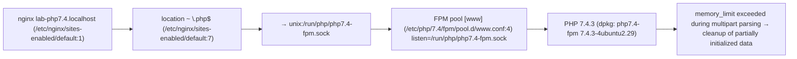
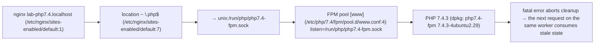

# PHP2Shell Exposure Check Report

**Host:** php7403-u20-fpm-userini  
**Checked at:** 2026-10-23 22:41:26  
**Tool:** php2shell_host.py v1.0 (Non-destructive: 0 commands executed, 0 network requests)  
**Basis:** PHP_취약점_동향_2026-10.en.md §2

## 1. Executive Summary

Across **1 serving paths**, 2 PHP2Shell (CVE-2026-109618 / CVE-2026-109619) findings were assessed: **1 Reachable**, 0 Mitigated (temporary), 1 Undetermined, 0 Patched.

> ℹ️ Configuration changes are a **temporary mitigation**. PHP has stated that configuration alone does not fully mitigate (PHP_취약점_동향_2026-10.en.md:96). 'Mitigated (temporary)' does not mean 'safe'.

> 🔎 There are 1 indicator-of-compromise items to review (§6). They are evidence that needs review, not verdicts.

## 2. Inspection targets (serving paths)

| ID | Target | Package version | Version verdict | Running | Web server |
|---|---|---|---|---|---|
| U01 | PHP 7.4 FPM pool [www] | 7.4.3-4ubuntu2.29 | PHP 7.4 has no official fixed release; only a source backport exists (PHP_취약점_동향_2026-10.en.md:69). No CVE backport recorded in changelog (/usr/share/doc/php7.4-fpm/changelog.Debian.gz). | running (started 2026-10-23 21:50:32) | nginx lab-php7.4.localhost |

## 3. Verdicts by CVE

| ID | CVE | Target | Severity | Verdict | Confidence | Fixed version | Rationale |
|---|---|---|---|---|---|---|---|
| F01 | CVE-2026-109618 | U01 | CVSS v4.0 9.2 | ⚪ Undetermined | medium | none (EOL) | FPM terminates the worker on startup failure, which blocks this path, but analysis suggests it may be vulnerable after startup, so it cannot be declared unreachable (DOC:44). |
| F02 | CVE-2026-109619 | U01 | CVSS v4.0 9.2 | 🔴 Reachable | high | none (EOL) | session.upload_progress is enabled (PHP default), so the session lifecycle path holds even without session_start(). Applies to both mod_php and FPM (DOC:54). |

## 4. Verdict basis (serving paths)

### F01 CVE-2026-109618 — Undetermined (U01)

**Condition:** `SAPI=fpm, memory_limit=128M (/etc/php/7.4/fpm/php.ini:409)`




### F02 CVE-2026-109619 — Reachable (U01)

**Condition:** `SAPI=fpm, session.upload_progress.enabled=1 (PHP default)`



- session.upload_progress.enabled=0 (/var/www/html/.user.ini:1) — .user.ini/ini_set is applied too late to have any effect (DOC:108).

## 5. Remediation

### 5.1 [Immediate] PHP 7.4: check whether the package source provides a backport

- **Problem:** PHP 7.4 has no official fixed release; only a source backport exists (PHP_취약점_동향_2026-10.en.md:69). No CVE backport recorded in changelog (/usr/share/doc/php7.4-fpm/changelog.Debian.gz).
- **Current:** php7.4-fpm 7.4.3-4ubuntu2.29
- **Location:** `official distribution package` (targets: U01)
- **Fix:**

```
Check the package source for security updates; if there are none, move to a supported branch.
```

- **Verify:**

```bash
zcat /usr/share/doc/php7.4-fpm/changelog.Debian.gz | grep -E 'CVE-2026-109618|CVE-2026-109619'
```

- **References:** PHP_취약점_동향_2026-10.en.md:69

### 5.2 [Temporary mitigation] CVE-2026-109619 temporary mitigation: disable session.upload_progress

- **Problem:** Upload progress, enabled by default, opens the stale state consumption path.
- **Current:** session.upload_progress.enabled=1 (PHP default)
- **Location:** `/etc/php/7.4/fpm/pool.d/www.conf` (targets: U01)
- **Fix:**

```
Add to the [www] section of /etc/php/7.4/fpm/pool.d/www.conf:
php_admin_value[session.upload_progress.enabled] = 0
※ ini_set() and .user.ini have no effect
```

- **Verify:**

```bash
sudo systemctl restart php7.4-fpm
sudo python3 php2shell_host.py  # re-run the check to confirm the verdict changed
```

- **Impact:** Session-based upload progress display will not work.
- **References:** PHP_취약점_동향_2026-10.en.md:54, :108

### 5.3 [Temporary mitigation] CVE-2026-109618 temporary mitigation: lock memory_limit + limit request size

- **Problem:** When memory_limit is exceeded during multipart parsing, partially initialized request data is cleaned up and memory corruption occurs.
- **Current:** memory_limit=128M (/etc/php/7.4/fpm/php.ini:409)<br>post_max_size=8M (/etc/php/7.4/fpm/php.ini:694)<br>upload_max_filesize=2M (/etc/php/7.4/fpm/php.ini:846)<br>nginx client_max_body_size=1m (default) (/etc/nginx/sites-enabled/default:1)
- **Location:** `/etc/php/7.4/fpm/pool.d/www.conf` (targets: U01)
- **Fix:**

```
Add to the [www] section of /etc/php/7.4/fpm/pool.d/www.conf:
php_admin_value[memory_limit] = -1

memory_limit=-1 removes the per-request cap, so also set a service-level memory cap:
sudo systemctl edit php7.4-fpm
  [Service]
  MemoryMax=<value for this server's memory>
(do not use RLIMIT_AS/RLIMIT_DATA)
```

- **Verify:**

```bash
sudo systemctl restart php7.4-fpm
sudo python3 php2shell_host.py  # re-run the check to confirm the verdict changed
```

- **Impact:** If the app does not use multipart, blocking multipart requests entirely in front of the web server is the most reliable option (DOC:105).
- **References:** PHP_취약점_동향_2026-10.en.md:101-105

### 5.4 [Temporary mitigation] Clean up ineffective mitigation settings

- **Problem:** Settings in this location are applied after request parsing and have no effect.
- **Current:** session.upload_progress.enabled=0 (/var/www/html/.user.ini:1)
- **Location:** `/var/www/html/.user.ini:1` (targets: U01)
- **Fix:**

```
Remove the line and move the setting to the pool/php.ini level.
```

- **Verify:**

```bash
sudo python3 php2shell_host.py  # re-run the check to confirm the verdict changed
```

- **References:** PHP_취약점_동향_2026-10.en.md:108

### 5.5 [Hardening] Stop exposing the PHP version header (expose_php)

- **Problem:** X-Powered-By discloses the PHP version, which is used to select attack targets.
- **Current:** expose_php=On (/etc/php/7.4/fpm/php.ini:379)
- **Location:** `/etc/php/7.4/fpm/php.ini:379` (targets: U01)
- **Fix:**

```
/etc/php/7.4/fpm/php.ini:379: expose_php = Off
```

- **Verify:**

```bash
sudo systemctl restart php7.4-fpm
curl -sI https://<host>/ | grep -i x-powered-by   # should print nothing
```


## 6. Indicators of compromise (needs review)

### Check for indicators of compromise: .php files changed since 2026-10-17

These may be legitimate changes from deployments. Compare with the deployment history and check any files that cannot be explained.

```
1 files

2026-10-23 01:52  /var/www/html/index.php
```

Verify: `find /var/www/html -name '*.php' -newermt 2026-10-17 -ls`


## 7. Transparency appendix

- **Commands executed:** 0 · **Network requests:** 0 · **Writes:** report directory (`/tmp/php2shell_report`) only
- **Files read:** 40 (full list in report.json `transparency.files_read`)
- **Files not read due to insufficient permissions:** 0
- **Limits:** config 4MiB, log tail 16MiB, webroot files 50000

**Limitations:**
- Effective values are computed by reading configuration files. They may differ from the actual values of the running process, and whether a restart applied them is estimated from file modification times.
- Apache php_value/php_admin_value are treated globally, without distinguishing VirtualHost/Directory.
- RHEL-family package versions cannot be checked (rpm DB not parsed). php-cgi, LiteSpeed, and FrankenPHP are not inspected.
- Exploitation success conditions such as memory layout and worker reuse (AC:H/AT:P) are not assessed.

## 8. Guidance for running legacy PHP servers

Most people already know that upgrading is the answer. The problem is how to handle the running server until then.

**1. Today: what you can do without stopping the service**

- Identify PHP paths and upload/admin screens exposed to the internet, and close unnecessary exposure first.
- Apply the temporary mitigations in §Remediation and restart all workers. Configuration alone does not fully mitigate (DOC:96, :108).
- Limit request size and the number of multipart parts in front of the web server/proxy, and block multipart for apps that do not use it (DOC:103, :105). A WAF is a stopgap that only affects traffic passing through it (DOC:115).
- Scope the compromise investigation from 2026-10-17, not from the disclosure date (DOC:125). The absence of logs does not mean safe (DOC:126).

**2. This week: obtain packages that include the security fix**

- Check distribution and LTS vendor packages for security updates. For distribution packages, check the changelog for backports (DOC:69, :72, :172).
- Check whether a fixed build is available through extended support services (e.g. paid extended security support from the distribution, commercial PHP long-term support). Confirm availability directly with the provider.
- PHP 7.3 and earlier have neither a PHP-side patch nor a source backport (DOC:70). Skip this step and go to steps 3 and 4.

**3. Upgrade path: migrate without downtime**

- The target is a branch with active security support. 8.2 reaches end of support on 2026-12-31, so 8.3 or later is recommended (DOC:161).
- Check compatibility first with static analysis (e.g. the PHPCompatibility rules for PHP_CodeSniffer) and automated refactoring tools (e.g. Rector), and confirm that the extensions, frameworks, and CMS in use support the target version.
- Run the new version side by side in a separate FPM pool or container, migrate in the order staging → partial traffic → full cutover, and keep a path to roll back to the previous version.

**4. When you cannot upgrade right away**

- Remove direct internet exposure: move the server behind an access-controlled internal network or VPN, or publish only the strictly necessary functions through a reverse proxy.
- CISA has recommended taking systems that cannot be patched or run 8.1 or earlier offline (DOC:114).
- If you still continue to operate it, document the risk acceptance: approving owner, compensating controls applied, and review deadline.

**5. When you find it on another organization's server**

- Do not inspect or verify it directly without permission. Notify the operator or the official reporting channel of the system's country (e.g. CISA in the US, NCSC in the UK, JPCERT/CC in Japan, KISA / KrCERT/CC in Korea).
- Do not disclose the vulnerability or the target until remediation is complete.

DOC in the references refers to PHP_취약점_동향_2026-10.en.md.
