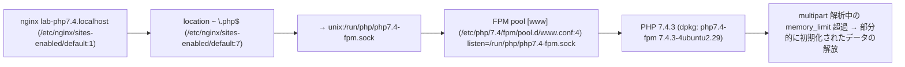
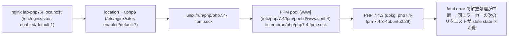

# PHP2Shell 露出点検レポート

**ホスト:** php7403-u20-fpm-userini  
**点検日時:** 2026-10-23 22:48:24  
**点検ツール:** php2shell_host.py v1.0 (非破壊: 実行コマンド0件、ネットワークリクエスト0件)  
**判定根拠:** PHP_취약점_동향_2026-10.ja.md §2

## 1. サマリー（Executive Summary）

サービング経路 **1個** で PHP2Shell（CVE-2026-109618 / CVE-2026-109619）2件を判定した結果、**到達可能 1件**、緩和済み（一時的） 0件、判定保留 1件、パッチ済み 0件です。

> ℹ️ 設定変更は **一時緩和** です。PHPは設定だけでは完全には緩和されないと明言しています（PHP_취약점_동향_2026-10.ja.md:96）。「緩和済み（一時的）」は「安全」ではありません。

> 🔎 侵害の痕跡の確認項目が 1件あります（§6）。判定ではなく、確認が必要な根拠です。

## 2. 点検対象（サービング経路）

| ID | 対象 | パッケージバージョン | バージョン判定 | 実行 | Webサーバー |
|---|---|---|---|---|---|
| U01 | PHP 7.4 FPM pool [www] | 7.4.3-4ubuntu2.29 | PHP 7.4 は公式の修正リリースがなく、ソースバックポートのみがあります（PHP_취약점_동향_2026-10.ja.md:69）。 changelog（/usr/share/doc/php7.4-fpm/changelog.Debian.gz）にCVEのバックポート記録なし。 | 実行中（起動 2026-10-23 21:50:31） | nginx lab-php7.4.localhost |

## 3. CVE別の判定

| ID | CVE | 対象 | 深刻度 | 判定 | 信頼度 | 修正バージョン | 根拠 |
|---|---|---|---|---|---|---|---|
| F01 | CVE-2026-109618 | U01 | CVSS v4.0 9.2 | ⚪ 判定保留 | medium | なし（EOL） | FPMは startup 失敗時にワーカーを終了するためこの経路は遮断されますが、startup 以降に脆弱となり得るという分析があり、到達不可とは断定できません（DOC:44）。 |
| F02 | CVE-2026-109619 | U01 | CVSS v4.0 9.2 | 🔴 到達可能 | high | なし（EOL） | session.upload_progress が有効（PHP既定値）なため、session_start() なしでもセッションのライフサイクル経路が成立します。mod_php・FPMの両方が該当します（DOC:54）。 |

## 4. 判定根拠（サービング経路）

### F01 CVE-2026-109618 — 判定保留 (U01)

**条件:** `SAPI=fpm, memory_limit=128M (/etc/php/7.4/fpm/php.ini:409)`




### F02 CVE-2026-109619 — 到達可能 (U01)

**条件:** `SAPI=fpm, session.upload_progress.enabled=1 (PHP既定値)`



- session.upload_progress.enabled=0 (/var/www/html/.user.ini:1) — .user.ini/ini_set は適用タイミングが遅いため効果がありません（DOC:108）。

## 5. 対処事項（Remediation）

### 5.1 [即時] PHP 7.4: パッケージ提供元でバックポートの有無を確認

- **問題:** PHP 7.4 は公式の修正リリースがなく、ソースバックポートのみがあります（PHP_취약점_동향_2026-10.ja.md:69）。 changelog（/usr/share/doc/php7.4-fpm/changelog.Debian.gz）にCVEのバックポート記録なし。
- **現在:** php7.4-fpm 7.4.3-4ubuntu2.29
- **場所:** `ディストリ公式パッケージ` （対象: U01）
- **対処:**

```
パッケージ提供元のセキュリティアップデートを確認し、なければサポート対象ブランチに移行します。
```

- **確認:**

```bash
zcat /usr/share/doc/php7.4-fpm/changelog.Debian.gz | grep -E 'CVE-2026-109618|CVE-2026-109619'
```

- **根拠:** PHP_취약점_동향_2026-10.ja.md:69

### 5.2 [一時緩和] CVE-2026-109619 一時緩和: session.upload_progress の無効化

- **問題:** 既定で有効な upload progress が stale state 消費の経路を開きます。
- **現在:** session.upload_progress.enabled=1 (PHP既定値)
- **場所:** `/etc/php/7.4/fpm/pool.d/www.conf` （対象: U01）
- **対処:**

```
/etc/php/7.4/fpm/pool.d/www.conf の [www] セクションに追加:
php_admin_value[session.upload_progress.enabled] = 0
※ ini_set()・.user.ini では効果なし
```

- **確認:**

```bash
sudo systemctl restart php7.4-fpm
sudo python3 php2shell_host.py  # 再点検で判定の変化を確認
```

- **影響:** セッションベースのアップロード進捗表示機能が動作しなくなります。
- **根拠:** PHP_취약점_동향_2026-10.ja.md:54, :108

### 5.3 [一時緩和] CVE-2026-109618 一時緩和: memory_limit のロック + リクエストサイズ制限

- **問題:** multipart 解析中の memory_limit 超過により、部分的に初期化されたリクエストデータが解放され、メモリ破損が発生します。
- **現在:** memory_limit=128M (/etc/php/7.4/fpm/php.ini:409)<br>post_max_size=8M (/etc/php/7.4/fpm/php.ini:694)<br>upload_max_filesize=2M (/etc/php/7.4/fpm/php.ini:846)<br>nginx client_max_body_size=1m（既定値） (/etc/nginx/sites-enabled/default:1)
- **場所:** `/etc/php/7.4/fpm/pool.d/www.conf` （対象: U01）
- **対処:**

```
/etc/php/7.4/fpm/pool.d/www.conf の [www] セクションに追加:
php_admin_value[memory_limit] = -1

memory_limit=-1 はリクエストごとの上限をなくすため、サービス単位のメモリ上限を併せて設定します:
sudo systemctl edit php7.4-fpm
  [Service]
  MemoryMax=<サーバーのメモリに合った値>
（RLIMIT_AS/RLIMIT_DATA は使用しません）
```

- **確認:**

```bash
sudo systemctl restart php7.4-fpm
sudo python3 php2shell_host.py  # 再点検で判定の変化を確認
```

- **影響:** アプリが multipart を使用しない場合は、Webサーバーの前段で multipart リクエスト自体を遮断するのが最も確実です（DOC:105）。
- **根拠:** PHP_취약점_동향_2026-10.ja.md:101-105

### 5.4 [一時緩和] 効果のない緩和設定の整理

- **問題:** この場所の設定はリクエスト解析後に適用されるため、効果がありません。
- **現在:** session.upload_progress.enabled=0 (/var/www/html/.user.ini:1)
- **場所:** `/var/www/html/.user.ini:1` （対象: U01）
- **対処:**

```
該当行を削除し、pool/php.ini レベルの設定に移します。
```

- **確認:**

```bash
sudo python3 php2shell_host.py  # 再点検で判定の変化を確認
```

- **根拠:** PHP_취약점_동향_2026-10.ja.md:108

### 5.5 [整備] PHPバージョンヘッダーの露出防止（expose_php）

- **問題:** X-Powered-By でPHPバージョンが公開され、攻撃対象の選別に使われます。
- **現在:** expose_php=On (/etc/php/7.4/fpm/php.ini:379)
- **場所:** `/etc/php/7.4/fpm/php.ini:379` （対象: U01）
- **対処:**

```
/etc/php/7.4/fpm/php.ini:379: expose_php = Off
```

- **確認:**

```bash
sudo systemctl restart php7.4-fpm
curl -sI https://<ホスト>/ | grep -i x-powered-by   # 出力がないこと
```


## 6. 侵害の痕跡の点検（要確認）

### 侵害の痕跡の確認: 2026-10-17 以降に変更された .php ファイル

デプロイによる正常な変更の可能性があります。デプロイ履歴と照合し、説明のつかないファイルを確認します。

```
1個

2026-10-23 01:52  /var/www/html/index.php
```

確認: `find /var/www/html -name '*.php' -newermt 2026-10-17 -ls`


## 7. 透明性付録

- **実行したコマンド:** 0件 · **ネットワークリクエスト:** 0件 · **書き込み:** レポートディレクトリ（`/tmp/php2shell_report`）のみ
- **読み取ったファイル:** 40個（全一覧は report.json `transparency.files_read`）
- **権限不足で読み取れなかったファイル:** 0個
- **上限:** 設定 4MiB、ログ末尾 16MiB、webrootファイル 50000個

**制限:**
- 設定ファイルを読み取って実効値を計算します。実行中のプロセスの実際の値とは異なる場合があり、再起動による反映の有無はファイルの変更日時から推定します。
- Apache の php_value/php_admin_value は VirtualHost・Directory の区別なくグローバルとして扱います。
- RHEL系はパッケージバージョンを確認できません（rpm DB 未解析）。php-cgi、LiteSpeed、FrankenPHP は点検しません。
- メモリレイアウト・ワーカーの再利用などエクスプロイト成功条件（AC:H/AT:P）は判定しません。

## 8. 運用中の旧バージョンPHPサーバーへの対応案内

アップグレードが答えであることは、たいてい既に分かっています。問題は、運用中のサーバーをそれまでどう扱うかです。

**1. 今日: サービスを止めずにできること**

- インターネットに公開されているPHPの経路とアップロード・管理画面を把握し、不要な公開から閉じます。
- §対処事項の一時緩和を適用し、すべてのワーカーを再起動します。設定だけでは完全には緩和されません（DOC:96, :108）。
- Webサーバー・プロキシの前段でリクエストサイズ・multipart のパート数を制限し、multipart を使わないアプリでは遮断します（DOC:103, :105）。WAFはその経路を通過するトラフィックにのみ有効な一時しのぎです（DOC:115）。
- 侵害調査の範囲は公開日ではなく 2026-10-17 から取ります（DOC:125）。ログがないからといって安全とは限りません（DOC:126）。

**2. 今週: セキュリティ修正を含むパッケージの確保**

- ディストリ・LTSベンダーのパッケージのセキュリティアップデートを確認します。ディストリのパッケージは changelog でバックポートの有無を確認します（DOC:69, :72, :172）。
- 延長サポートサービス（例：ディストリの有償延長セキュリティサポート、商用PHPの長期サポート）で修正版を入手できるか確認します。提供の有無は提供元に直接確認する必要があります。
- PHP 7.3 以下はPHP側のパッチもソースバックポートもありません（DOC:70）。この段階を飛ばして3・4段階に進みます。

**3. アップグレード経路: 無停止で移行する**

- 目標はセキュリティサポート中のブランチです。8.2 は 2026-12-31 にサポートが終了するため、8.3 以上を推奨します（DOC:161）。
- 互換性は静的解析（例：PHP_CodeSniffer の PHPCompatibility ルール）と自動変換ツール（例：Rector）でまず確認し、使用中の拡張モジュール・フレームワーク・CMSが目標バージョンをサポートしているか確認します。
- 新バージョンを別の FPM pool やコンテナで並行して立ち上げ、ステージング → 一部トラフィック → 全面切り替えの順に移行し、旧バージョンに戻す経路を残しておきます。

**4. すぐにアップグレードできない場合**

- インターネットへの直接露出をなくし、アクセス制御された内部ネットワーク・VPNの背後に移すか、必要な機能だけをリバースプロキシで公開します。
- CISAは、パッチできない、または 8.1 以下のシステムのオフライン化を勧告しました（DOC:114）。
- それでも運用を続ける場合は、リスク受容を文書に残します: 承認責任者、適用した補完的統制、再検討期限。

**5. 他組織のサーバーで発見した場合**

- 許可なく直接点検・検証しません。運用主体または公式の届出窓口（日本ではIPA・JPCERT/CC、韓国ではKISA・KrCERT/CC）に通知します。
- 対処が完了するまでは、脆弱性の事実と対象を公開しません。

根拠表記の DOC は PHP_취약점_동향_2026-10.ja.md です。
