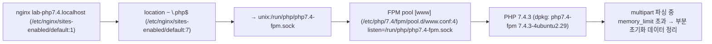
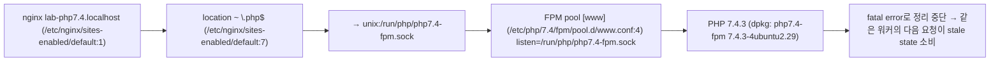

# PHP2Shell 노출 점검 보고서

**호스트:** php7403-u20-fpm-userini  
**점검 시각:** 2026-10-23 22:48:26  
**점검 도구:** php2shell_host.py v1.0 (비파괴: 실행 명령 0건, 네트워크 요청 0건)  
**판정 근거:** PHP_취약점_동향_2026-10.md §2

## 1. 요약 (Executive Summary)

서빙 경로 **1개**에서 PHP2Shell(CVE-2026-109618 / CVE-2026-109619) 2건을 판정한 결과 **도달가능 1건**, 완화됨(임시) 0건, 판정보류 1건, 패치됨 0건입니다.

> ℹ️ 설정 변경은 **임시 완화**입니다. PHP는 설정만으로 완전히 완화되지 않는다고 밝혔습니다(PHP_취약점_동향_2026-10.md:96). '완화됨(임시)'은 '안전'이 아닙니다.

> 🔎 침해 징후 확인 항목 1건이 있습니다(§6). 판정이 아니라 확인이 필요한 근거입니다.

## 2. 점검 대상 (서빙 경로)

| ID | 대상 | 패키지 버전 | 버전 판정 | 실행 | 웹서버 |
|---|---|---|---|---|---|
| U01 | PHP 7.4 FPM pool [www] | 7.4.3-4ubuntu2.29 | PHP 7.4는 공식 수정 릴리스가 없고 소스 백포트만 있습니다(PHP_취약점_동향_2026-10.md:69). changelog(/usr/share/doc/php7.4-fpm/changelog.Debian.gz)에 CVE 백포트 기록 없음. | 실행 중 (시작 2026-10-23 21:50:31) | nginx lab-php7.4.localhost |

## 3. CVE별 판정

| ID | CVE | 대상 | 심각도 | 판정 | 신뢰도 | 수정버전 | 근거 |
|---|---|---|---|---|---|---|---|
| F01 | CVE-2026-109618 | U01 | CVSS v4.0 9.2 | ⚪ 판정보류 | medium | 없음(EOL) | FPM은 startup 실패 시 워커를 종료해 이 경로가 차단되지만, startup 이후 취약할 수 있다는 분석이 있어 도달불가로 단정할 수 없습니다(DOC:44). |
| F02 | CVE-2026-109619 | U01 | CVSS v4.0 9.2 | 🔴 도달가능 | high | 없음(EOL) | session.upload_progress가 활성(PHP 기본값)이라 session_start() 없이도 세션 라이프사이클 경로가 성립합니다. mod_php·FPM 모두 해당(DOC:54). |

## 4. 판정 근거 (서빙 경로)

### F01 CVE-2026-109618 — 판정보류 (U01)

**조건:** `SAPI=fpm, memory_limit=128M (/etc/php/7.4/fpm/php.ini:409)`




### F02 CVE-2026-109619 — 도달가능 (U01)

**조건:** `SAPI=fpm, session.upload_progress.enabled=1 (PHP 기본값)`



- session.upload_progress.enabled=0 (/var/www/html/.user.ini:1) — .user.ini/ini_set은 적용 시점이 늦어 효과가 없습니다(DOC:108).

## 5. 조치 사항 (Remediation)

### 5.1 [즉시] PHP 7.4: 패키지 공급원에 백포트 여부 확인

- **문제:** PHP 7.4는 공식 수정 릴리스가 없고 소스 백포트만 있습니다(PHP_취약점_동향_2026-10.md:69). changelog(/usr/share/doc/php7.4-fpm/changelog.Debian.gz)에 CVE 백포트 기록 없음.
- **현재:** php7.4-fpm 7.4.3-4ubuntu2.29
- **위치:** `배포판 공식 패키지` (대상: U01)
- **조치:**

```
패키지 공급원의 보안 업데이트를 확인하고, 없으면 지원 브랜치로 이전합니다.
```

- **확인:**

```bash
zcat /usr/share/doc/php7.4-fpm/changelog.Debian.gz | grep -E 'CVE-2026-109618|CVE-2026-109619'
```

- **근거:** PHP_취약점_동향_2026-10.md:69

### 5.2 [임시 완화] CVE-2026-109619 임시 완화: session.upload_progress 비활성화

- **문제:** 기본 활성 상태의 upload progress가 stale state 소비 경로를 엽니다.
- **현재:** session.upload_progress.enabled=1 (PHP 기본값)
- **위치:** `/etc/php/7.4/fpm/pool.d/www.conf` (대상: U01)
- **조치:**

```
/etc/php/7.4/fpm/pool.d/www.conf 의 [www] 섹션에 추가:
php_admin_value[session.upload_progress.enabled] = 0
※ ini_set()·.user.ini로는 효과 없음
```

- **확인:**

```bash
sudo systemctl restart php7.4-fpm
sudo python3 php2shell_host.py  # 재점검으로 판정 변화 확인
```

- **영향:** 세션 기반 업로드 진행률 표시 기능이 동작하지 않습니다.
- **근거:** PHP_취약점_동향_2026-10.md:54, :108

### 5.3 [임시 완화] CVE-2026-109618 임시 완화: memory_limit 잠금 + 요청 크기 제한

- **문제:** multipart 파싱 중 memory_limit 초과로 부분 초기화된 요청 데이터가 정리되며 메모리 손상이 일어납니다.
- **현재:** memory_limit=128M (/etc/php/7.4/fpm/php.ini:409)<br>post_max_size=8M (/etc/php/7.4/fpm/php.ini:694)<br>upload_max_filesize=2M (/etc/php/7.4/fpm/php.ini:846)<br>nginx client_max_body_size=1m(기본값) (/etc/nginx/sites-enabled/default:1)
- **위치:** `/etc/php/7.4/fpm/pool.d/www.conf` (대상: U01)
- **조치:**

```
/etc/php/7.4/fpm/pool.d/www.conf 의 [www] 섹션에 추가:
php_admin_value[memory_limit] = -1

memory_limit=-1은 요청별 상한을 없애므로 서비스 단위 메모리 상한을 함께 둡니다:
sudo systemctl edit php7.4-fpm
  [Service]
  MemoryMax=<서버 메모리에 맞는 값>
(RLIMIT_AS/RLIMIT_DATA는 사용하지 않습니다)
```

- **확인:**

```bash
sudo systemctl restart php7.4-fpm
sudo python3 php2shell_host.py  # 재점검으로 판정 변화 확인
```

- **영향:** 앱이 multipart를 쓰지 않으면 웹서버 앞단에서 multipart 요청 자체를 차단하는 것이 가장 확실합니다(DOC:105).
- **근거:** PHP_취약점_동향_2026-10.md:101-105

### 5.4 [임시 완화] 효과 없는 완화 설정 정리

- **문제:** 이 위치의 설정은 요청 파싱 이후 적용되어 효과가 없습니다.
- **현재:** session.upload_progress.enabled=0 (/var/www/html/.user.ini:1)
- **위치:** `/var/www/html/.user.ini:1` (대상: U01)
- **조치:**

```
해당 줄을 제거하고 pool/php.ini 수준 설정으로 옮깁니다.
```

- **확인:**

```bash
sudo python3 php2shell_host.py  # 재점검으로 판정 변화 확인
```

- **근거:** PHP_취약점_동향_2026-10.md:108

### 5.5 [정비] PHP 버전 헤더 노출 차단(expose_php)

- **문제:** X-Powered-By로 PHP 버전이 공개되어 공격 대상 선별에 쓰입니다.
- **현재:** expose_php=On (/etc/php/7.4/fpm/php.ini:379)
- **위치:** `/etc/php/7.4/fpm/php.ini:379` (대상: U01)
- **조치:**

```
/etc/php/7.4/fpm/php.ini:379: expose_php = Off
```

- **확인:**

```bash
sudo systemctl restart php7.4-fpm
curl -sI https://<호스트>/ | grep -i x-powered-by   # 출력이 없어야 함
```


## 6. 침해 징후 점검 (확인 필요)

### 침해 징후 확인: 2026-10-17 이후 변경된 .php 파일

배포에 의한 정상 변경일 수 있습니다. 배포 이력과 대조해 설명되지 않는 파일을 확인합니다.

```
1개

2026-10-23 01:52  /var/www/html/index.php
```

확인: `find /var/www/html -name '*.php' -newermt 2026-10-17 -ls`


## 7. 투명성 부록

- **실행한 명령:** 0건 · **네트워크 요청:** 0건 · **쓰기:** 보고서 디렉터리(`/tmp/php2shell_report`)만
- **읽은 파일:** 40개 (전체 목록은 report.json `transparency.files_read`)
- **권한 부족으로 읽지 못한 파일:** 0개
- **상한:** 설정 4MiB, 로그 끝 16MiB, 웹루트 파일 50000개

**한계:**
- 설정 파일을 읽어 실효값을 계산합니다. 실행 중인 프로세스의 실제 값과 다를 수 있으며, 재시작 반영 여부는 파일 수정 시각으로 추정합니다.
- Apache의 php_value/php_admin_value는 VirtualHost·Directory 구분 없이 전역으로 취급합니다.
- RHEL 계열은 패키지 버전을 확인하지 못합니다(rpm DB 미해석). php-cgi, LiteSpeed, FrankenPHP는 점검하지 않습니다.
- 메모리 레이아웃·워커 재사용 등 익스플로잇 성공 조건(AC:H/AT:P)은 판정하지 않습니다.

## 8. 운영 중인 구버전 PHP 서버 대응 안내

업그레이드가 답이라는 것은 대개 이미 알고 있습니다. 문제는 운영 중인 서버를 그때까지 어떻게 다루느냐입니다.

**1. 오늘: 서비스를 멈추지 않고 할 수 있는 일**

- 인터넷에 공개된 PHP 경로와 업로드·관리 화면을 파악하고, 불필요한 공개부터 닫습니다.
- §조치 사항의 임시 완화를 적용하고 모든 워커를 재시작합니다. 설정만으로는 완전히 완화되지 않습니다(DOC:96, :108).
- 웹서버·프록시 앞단에서 요청 크기·multipart 파트 수를 제한하고, multipart를 쓰지 않는 앱은 차단합니다(DOC:103, :105). WAF는 그 경로를 지나는 트래픽에만 효과가 있는 임시방편입니다(DOC:115).
- 침해 조사 범위는 공개일이 아니라 2026-10-17부터 잡습니다(DOC:125). 로그가 없다고 안전한 것은 아닙니다(DOC:126).

**2. 이번 주: 보안 수정이 들어간 패키지 확보**

- 배포판·LTS 벤더 패키지의 보안 업데이트를 확인합니다. 배포판 패키지는 changelog로 백포트 여부를 확인합니다(DOC:69, :72, :172).
- 확장 지원 서비스(예: 배포판의 유료 확장 보안 지원, 상용 PHP 장기 지원)로 수정판을 받을 수 있는지 확인합니다. 제공 여부는 공급자에게 직접 확인해야 합니다.
- PHP 7.3 이하는 PHP 측 패치와 소스 백포트가 없습니다(DOC:70). 이 단계를 건너뛰고 3·4단계로 갑니다.

**3. 업그레이드 경로: 중단 없이 옮기기**

- 목표는 보안 지원 중인 브랜치입니다. 8.2는 2026-12-31에 지원이 끝나므로 8.3 이상을 권장합니다(DOC:161).
- 호환성은 정적 분석(예: PHP_CodeSniffer의 PHPCompatibility 규칙)과 자동 변환 도구(예: Rector)로 먼저 확인하고, 사용 중인 확장 모듈·프레임워크·CMS가 목표 버전을 지원하는지 확인합니다.
- 새 버전을 별도 FPM pool이나 컨테이너로 나란히 띄워 스테이징 → 일부 트래픽 → 전체 전환 순으로 옮기고, 이전 버전으로 되돌릴 경로를 남겨 둡니다.

**4. 당장 업그레이드할 수 없을 때**

- 인터넷 직접 노출을 없애고, 접근 통제된 내부망·VPN 뒤로 옮기거나 꼭 필요한 기능만 리버스 프록시로 공개합니다.
- CISA는 패치할 수 없거나 8.1 이하인 시스템의 오프라인 전환을 권고했습니다(DOC:114).
- 그래도 운영을 계속한다면 위험 수용을 문서로 남깁니다: 승인 책임자, 적용한 보완 통제, 재검토 기한.

**5. 다른 조직의 서버에서 발견했을 때**

- 허가 없이 직접 점검·검증하지 않습니다. 운영 주체나 공식 신고 채널(국내는 KISA 보호나라·KrCERT/CC)로 알립니다.
- 조치가 끝나기 전에는 취약 사실과 대상을 공개하지 않습니다.

근거 표기의 DOC는 PHP_취약점_동향_2026-10.md입니다.
